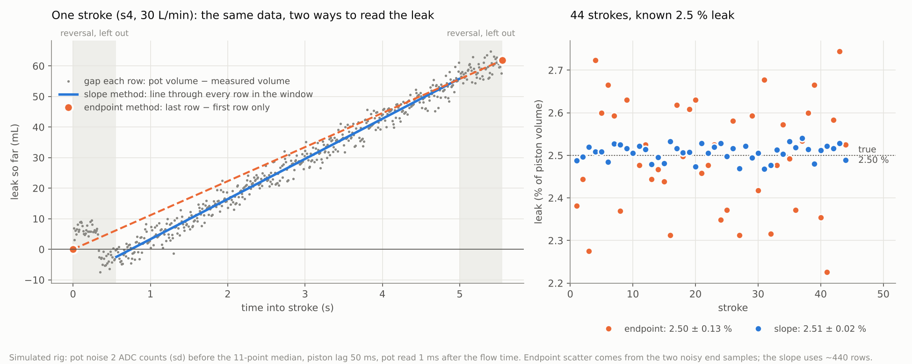

# Mech-Lung

Arduino UNO R4 WiFi sketches for the piston-cylinder mechanical lung: a Jrk G2
driven actuator, an SFM3000 flow sensor and seven SDP811 pressure sensors.

The current platform is `MechanicalLungPlatform` driven by
`logger/mechlungdatalogger.py`. The leak and flow correction tests that set its
constants are finished; their sketches and `leaktest.py` stay as the record.

## Layout

| Path | What it is |
|---|---|
| `MechanicalLungPlatform/` | The platform sketch. Breathing presets `1` to `4` and steady flow `s1` to `s4` (10, 15, 20, 30 L/min) with their flow corrections, actuator in a 1 kHz timer interrupt, raw 100 Hz rows with read times. No plot mode or monitor messages: start-up sensor checks, rows and the `# config` reply only. Needs the `Sensirion Core` library (Library Manager; compiles with 0.7.3). |
| `logger/mechlungdatalogger.py` | Drives the platform from the PC (Windows, Python 3 + pyserial): asks T, P and a queue, tares, runs each item, works out the figures and saves each run under `logger/runs/`. |
| `MechLung_LeakTest/`, `MechLung_CorrectionFactorTest/`, `MechLung_SteadyStateTest/` | Finished leak and correction test sketches (plot mode, log mode with key L). |
| `logger/leaktest.py` | Finished: the PC side of the test sketches. |
| `breakouts/B1_serial_throughput/` | Serial throughput test and `b1_reader.py` (PC gap counter). |
| `breakouts/B2_timer_dac/` | 1 kHz timer interrupt writing the DAC register directly. Disconnect the Jrk from A0 first. |
| `breakouts/B3_plotter/` | Arduino IDE 2 Serial Plotter window size and nan display (test sketches only). |
| `breakouts/B4_blocked_leak/` | Blocked-outlet leak test: seal leak against pressure from the pot alone, no SFM3000 in the figure. Run with `leaktest.py` (items `b1` to `b5`). |

## Running the platform

1. Set the Jrk travel limits. Upload `MechanicalLungPlatform` (double-tap reset
   first, see below).
2. Close the Arduino IDE (it holds the port), then `pip install pyserial` once
   and `python mechlungdatalogger.py COM3` (no port: lists the ports).
3. Enter room temperature (C), MSL pressure (hPa, from BoM) and a queue:
   - `4x20`: preset 4, 20 complete breaths
   - `s2x6`: steady flow s2, 6 complete strokes
   - `c600`: clock check, 600 s of rows at idle (see Clock check)

   e.g. `c600, s1x6, s4x6, 2x10`.

The logger first asks for `# config` and prints the start-up checks (SFM3000,
SDP811 p1 to p7, timer, Wire1 bus recovery); it stops if the SFM3000 or the
timer is missing. Then for each item, with no further input, it: sends H and
waits for idle at centre, tares, starts the item, counts N breaths or strokes,
sends H and waits for centre. One console line per breath or stroke, a timing
and clock line per item, and a summary at the end. Ctrl+C stops the actuator,
saves and marks the run aborted.

Each item is saved in `logger/runs/<date>_<hhmmss>_<item>/`:

- `samples.csv`: the sketch's rows, plus `pc_s`, the PC arrival time (s from the
  first row).
- `events.log`: the `#` lines, each with the tick it followed.
- `meta.json`: conditions, `# config`, the tare, the timing and clock figures,
  and the per-breath or per-stroke figures.

The logger converts MSL to station pressure with `ELEVATION_M = 27` (VU
Footscray Park, Building D level 3: RL 26.1 m plus bench).

`TARE_SETTLE_S` (2 s) is confirmed: on 29 Oct 2026 all 20 tares zeroed cleanly (flow
0.004 to 0.015 slm, every SDP811 within +-0.1 Pa). The tare's `pot_spread_dac` in
`meta.json` is unreliable: pot spikes at rest can read hundreds of DAC counts while the
piston is still (6 of 20 tares, up to 1155). Judge a tare by its flow zero.

## PC link: native USB

The UNO R4 WiFi's USB normally goes through its ESP32-S3 bridge chip. In B1 the
bridge's output to Python stalled after 3 to 67 s at 100 rows/s (a known,
unfixed issue). So the platform sets `NATIVE_USB 1`: at boot the USB-C port is
switched to the RA4M1's own USB, bypassing the bridge.

- The board appears as a different COM port. The baud setting is ignored
  (never use 1200, which resets the board).
- Uploading: double-tap the reset button, then upload. Retry once if it fails.
  If no port appears at all, unplug and replug USB.
- Rows stream all the time, but only while a program has the port open (DTR
  set: the logger and the IDE Serial Monitor set it). Lines sent before that,
  including the start-up checks, are dropped; the logger reads the check results
  from `# config`.
- Rows are about 125 bytes (B1 measured 68-byte rows). Native USB carries that
  easily; `NATIVE_USB 0` would need at least 230400 baud and the bridge still stalls.

## Keys

`1` to `4` breathe, `s1` to `s4` steady flow, `max` / `min` go to that end and
hold, `H` returns to centre, `c` sends `# config`. Keys that do not apply in the
current mode are ignored without a message (start keys while returning, or at
max or min); the logger reads the mode column instead.

Steady flow: the piston ramps to min, holds `SS_DWELL_MS` (1 s), then moves at
constant speed min to max (air out, + flow), holds 1 s, moves back, holds 1 s,
and so on. The holds let the piston and the pressures settle, so every stroke
starts and ends at rest. Each stroke (a move plus the hold at its end) is one
`breath` in the rows; the counter goes up as each move starts. The stroke runs
over the calibrated Jrk window less `SS_MARGIN_JRK` (20 Jrk counts, about 1.1 mm)
at each end, so a Jrk overshoot at the reversal stays inside the window:
221 mm less 2.2 mm, 2866 mL.

## Rows

One row per 100 Hz sample tick:

```
tick,us,breath,mode,cmd_dac,pot_raw,sfm_raw,sfm_n,sfm_span_us,pot_dus,p1_raw..p7_raw,p1_dus..p7_dus
```

| Column | Meaning |
|---|---|
| `tick` | 100 Hz sample tick from the timer interrupt. A gap is a lost row. |
| `us` | `micros()` at the start of the tick's SFM3000 read: the row's time origin. |
| `breath` | +1 at each breath start (steady flow: each stroke). |
| `mode` | 0 to 3 breathing presets, 4 to 7 steady s1 to s4, -1 idle, -3 returning, -4 moving to an end (and the hold before steady flow), -5 holding there. |
| `cmd_dac` | Command written to the DAC at the tick. |
| `pot_raw` | Position pot, raw ADC. |
| `sfm_raw` | SFM3000 word: mean of the `sfm_n` reads in the tick's window. |
| `sfm_n` | Reads in that mean (4 when the window was complete). |
| `sfm_span_us` | First read of the window to the tick's read (ideal 7500 us). |
| `pot_dus` | Pot read start minus `us`. |
| `pN_raw` | SDP811 pressure word, Pa = raw / `sdp_scale`. |
| `pN_dus` | pN read start minus `us`. |

Sensor values are raw and untared. A failed read is an empty field (with an
empty `_dus` if the read was not attempted).

Flow is averaged over each 10 ms tick: the SFM3000 is read 4 times per tick,
2.5 ms apart, and the mean is logged. Evenly spaced reads cancel ripple at 100,
200 and 300 Hz, so the Jrk's 100 Hz update cannot alias into the volume. 4 reads
replace the earlier 10 (1 ms apart), which locked the SFM3000 up. Any failed read
in the window empties the tick's flow. An SFM3000 that returns the same raw word
for 50 ticks in a row (frozen after a power glitch) or a word outside its +-200
slm range gives failed reads, not values.

## Timing: what a row's values mean in time

One ADC and two I2C buses read in turn, so a row's values cannot be sampled at
the same instant. Each row says when each read started instead (`micros()`
offsets from `us`), and the logger reports them per item as a `timing:` line and
under `timing` in `meta.json`:

- The flow mean stands for the volume moved up to about
  `us + sfm_span_us / (2 (sfm_n - 1))`: 1.25 ms after `us` for 4 evenly spaced reads.
  This is the flow time the other offsets are given against.
- The pot is read straight after the tick's SFM3000 read (`pot_dus` about 0.4 ms),
  so it lands within about 1 ms of the flow time.
- p1 to p7 are read one after another over about 3 ms after that.
- `row_spacing_us` (from `us`) shows the loop's latency jitter; `sfm_span_us` shows
  whether the averaging reads landed on their 2.5 ms slots (a slot that falls
  inside the SDP811 burst is read late); `sfm_short_rows` counts windows that got
  fewer than 4 reads.

`micros()` runs on the same clock as the ticks, so these offsets are exact
relative to each other but cannot show a clock error: that is the clock check.

## Figures

Pot volume (mL from centre) comes from the pot through an 11-point median, which
removes the rig's pot spikes and runs 5 rows (50 ms) behind a moving piston; the
logger compares it with the flow volume 5 rows back.

**Steady flow** (per stroke, under `strokes` in `meta.json`):

- `leak_pct`, `leak_rate_mLs` (main figure, slope leak): over the middle of the
  move (`TRIM` = 10 % of the move time off each end) a straight line is fitted to
  the pot volume against time; its slope is the piston's rate. The measured rate
  is the mean SFM3000 flow over the same window. Leak = the difference. Every row
  in the window counts, so pot noise averages out, and a time offset between pot
  and flow shifts the line without changing its slope, so it cannot bias the
  leak. A failed flow read drops one row from the mean; a stroke needs good flow
  on 90 % of the window.

  

  Left: one simulated s4 stroke with a known 2.5 % leak, the gap between pot
  and measured volume on every row. The endpoint figure is the last sample minus
  the first, so the noise on those two samples is the whole error; the slope
  figure is a line through every row in the window. Right: 44 strokes, endpoint
  2.50 +/- 0.13 %, slope 2.51 +/- 0.02 %. (Made with the earlier simulation, no
  holds at the stroke ends, hence the bump at the start of the stroke.)
- `endpoint_leak_pct`: pot volume moved over the whole stroke minus the flow
  volume. Kept alongside; any failed flow read in the stroke makes it nan, and
  pot noise at the two end samples gives it a few mL of scatter.
- `flow_pct`: mean flow over the 10 to 90 % window against the target;
  `flow_pct_inner`: the same over 20 to 80 %. If they differ, the piston is still
  settling from the start of the move inside the window.
- `p_mean_Pa`: mean p1 to p7 over the window, for leak against pressure.
- `first`: the first stroke after the ramp to min. The summary leaves it out,
  and leaves out strokes with lost rows or too little good flow; it gives out and
  in strokes separately.

**Breathing** (per breath, under `breaths`): push leak = pot volume rise minus
measured volume rise over the push; return leak = the same for the fall from the
peak to breath end. The measured volume starts each breath at the pot volume, so
both measure from centre. Any failed flow read in the breath, or in the 4 rows
before it that seed it, makes the breath nan (no gap in a volume is bridged).
The summary leaves out breaths with lost rows.

## Clock check

All volumes from flow are flow x 10 ms per tick, with the 10 ms counted by the
board's clock. The RA4M1 runs from an internal oscillator, so if its tick is
longer than 10 ms by some fraction, the flow volumes and the commanded speeds
both read low by that fraction and every leak figure reads high by it (1 % would
be 29 mL on a full stroke). The pot volume does not depend on time.

The logger measures it from when rows reach the PC: they arrive in bursts, late
by a varying amount but never early, so the earliest arrival in each second
traces the board's clock against the PC's. Every item reports
`clock: board +N +/- M ppm` (+ = the board runs slow); a short item gives a rough
figure, a `c600` item a good one (a few ppm). The figure is reported only, not
applied: if it is more than about 100 ppm (0.01 %), take it into account when
reading leak and flow figures.

## Accuracy limits

Leak = pot volume minus SFM3000 volume, so it carries every scale error of both:

- SFM3000: about +-1.5 % of reading (datasheet). There is no independent volume
  reference on the rig (no calibration syringe), so this is accepted. The flow
  corrections are target / SFM3000 reading: they make the SFM3000 read the
  target, not the true flow.
- Pot volume: `ACTUATOR_STROKE_MM` (221 mm) and `CYLINDER_DIAMETER_MM`
  (129.15 mm). 1 mm of stroke is 0.45 %, 0.1 mm of bore 0.15 %.
- Board clock: see Clock check.
- T and P entered per session: 1 C is 0.34 %, 3 hPa 0.3 %.

A real seal leak should fall to zero at zero pressure; a scale error does not.
Plotting per-stroke `leak_pct` against `p_mean_Pa` across s1 to s4 separates the
two: the intercept at zero pressure is the scale error.

## Flow corrections

Breathing presets (`FLOW_GAIN_ON`, `GAIN_EXP`, `GAIN_INSP`) scale each preset so
the peak flow at the SFM3000 meets the target (29 Oct 2026, non-MAD model, Jrk
P 8). Peak flow is a half-sine of the commanded length fitted to the middle 60 %
of each phase with its timing free: the raw maximum reads 5 to 90 % high from
push ripple, and the measured flow trails the command by about 0.15 s after the
stall at each reversal. Raising `GAIN_EXP` also raises the tidal volume (preset 1
about 5 %). `GAIN_EXP` scales the stroke; the inspiration time is scaled by
`GAIN_EXP / GAIN_INSP`.

Steady flow (`SS_GAIN_ON`, `SS_GAIN_OUT`, `SS_GAIN_IN`) scales the piston speed
of each stroke so the mean mid-stroke flow at the SFM3000 meets the target.
Gains = target / measured from the uncorrected 28 Oct 11:03 runs (full window,
no holds):

| Mode | Target L/min | Out measured | In measured | `SS_GAIN_OUT` | `SS_GAIN_IN` |
|---|---|---|---|---|---|
| s1 | 10 | 98.33 % | 98.73 % | 1.0170 | 1.0129 |
| s2 | 15 | 97.43 % | 97.74 % | 1.0263 | 1.0231 |
| s3 | 20 | 96.99 % | 97.28 % | 1.0310 | 1.0280 |
| s4 | 30 | 95.73 % | 95.90 % | 1.0446 | 1.0428 |

The platform's margin and end holds change the stroke ends, so check the gains
with one corrected run of each mode.

## Leak and correction tests (finished)

`MechLung_LeakTest`, `MechLung_CorrectionFactorTest` and
`MechLung_SteadyStateTest` with `leaktest.py`: plot mode (Arduino IDE Serial
Plotter, `PLOT_DIV`) and log mode (key L, raw rows
`tick,breath,mode,cmd_dac,pot_raw,sfm_raw,p1_raw..p7_raw`), tare in the sketch,
per-breath and per-stroke figures in both the sketch and the logger. To run
them: B1 (`LINE_BYTES = 68`), B2 and B3 first, set `TARE_SETTLE_MS` and
`TARE_STILL_COUNTS`, then `python leaktest.py COM3`. Their per-stroke steady leak
is the endpoint figure; their plot-mode figures use fixed T and P (20 C,
1013 hPa) and add one tick of flow at the end of each stroke.

## Blocked-outlet leak test (B4)

Every leak figure above is pot volume minus SFM3000 volume, so it carries the
SFM3000's scale error. With the outlet plugged nothing flows through the line,
every SDP811 reads cylinder pressure, and once the pressure is level all the air
the piston displaces leaves past the seal or a joint:

    leak = piston rate (pot slope) x (1 + p / P_station)    (ambient L/min)

Setup: plug the airway model's open end, so every SDP811 tap is upstream of the
plug. Upload `B4_blocked_leak` (double-tap reset), then `python leaktest.py COM8`
with a queue such as `b1x4, b2x4, b3x4, b4x4, b5x4` (about 10 min).

- `b1` to `b5`: 0.25, 0.5, 1, 2, 4 mm/s (0.2 to 3.1 L/min of displacement;
  `BL_SPEED_MM_S`). Each item ramps to centre less half a move, dwells 3 s,
  then out move 20 s, dwell 3 s, in move 20 s, dwell 3 s, ... The ramps (H and
  to the start point) run at the test speed, so they build no more pressure than
  the test.
- Per move (`moves` in `meta.json`): `leak_Lmin` (pot slope over the middle 80 %
  of the move), `p_mean_Pa` (mean of p1 to p7), `downstream_Lmin` (SFM3000 flow:
  air leaving between the SFM3000 and the plug, mainly through the seven
  flow-through SDP811s, plus any joint leak there), `seal_Lmin` =
  leak - downstream (seal and joints upstream of the SFM3000), `p_slope_Pa_s`
  (should be ~0: level pressure), `p_rest_Pa` (end of the dwell, should be ~0),
  `p_spread_Pa` (sensor to sensor, ~0 with no flow), `track_pct` (pot rate
  against commanded rate).
- The summary fits `seal leak = k |p|^n` per direction over all `b` items.
  Feed it the cylinder pressure of an open run to predict that run's seal leak;
  the open-run leak figure minus that prediction is the SFM3000 and geometry
  scale error.
- Pressure limit: any SDP811 past +-450 Pa (`BL_P_LIMIT_PA`) while the piston
  moves stops the command where it is and `leaktest.py` stops the queue (speeds
  run in ascending order, so the lower ones are saved). Unplug, then H.
- SDP811 flow-through: each SDP811 passes air from its tap to its open port,
  about 33-43 sccm at 100 Pa and 90-115 sccm at 500 Pa (Sensirion DP
  Engineering Guide, wide device spread). The summary gives `downstream_Lmin`
  per sensor to compare; well above that points to a joint leak. The same
  bleed runs in normal tests: the flow leaving the model outlet is the SFM3000
  flow less the seven sensor flows, and the B4 `downstream_Lmin` against
  `p_mean_Pa` measures that curve.
- The leak figure depends only on the pot scale: `ACTUATOR_STROKE_MM`
  (1 mm = 0.45 %) and `CYLINDER_DIAMETER_MM` (0.1 mm = 0.15 %).

At 0.25 mm/s the command moves 1 DAC count every 0.22 s; if the Jrk moves the
piston in steps, the pressure ripples but the window figures still balance
(the move is long against the cylinder's time constant). Check `p_slope_Pa_s`
and `track_pct`.

Tested on the PC only: the sketch compiled against stand-ins for the Arduino
core, Wire, Sensirion Core and the timer, run against a simulated plugged
cylinder (seal 0.57 |p|^0.8 mL/s, downstream bleed 0.01 p mL/s, 50 ms piston
lag, pot and sensor noise) with `leaktest.py` over a pseudo-terminal: fit
k 0.033 to 0.034 (true 0.034 L/min), n 0.80 to 0.81 (true 0.80); with a tighter
seal (k x 0.18) the limit stopped `b4` and the fit from `b1` and `b3` was
k 0.0059 (true 0.0060), n 0.80.

## Status

`MechanicalLungPlatform` has not yet been compiled for the R4 or run on the rig.
It was compiled on a PC with stand-ins for the Arduino core, the Wire and
Sensirion Core libraries and the timer, and run against a simulated rig
(lagging piston, a known 2.5 % leak, a board clock 500 ppm slow, pot noise and
spikes, occasional failed reads), with `mechlungdatalogger.py` driving it over
a pseudo-terminal. On the R4, check first: it compiles, the start-up checks
pass, rows arrive with `sfm_n` 4 and `sfm_span_us` near 7500, and a `c600`
clock check.
